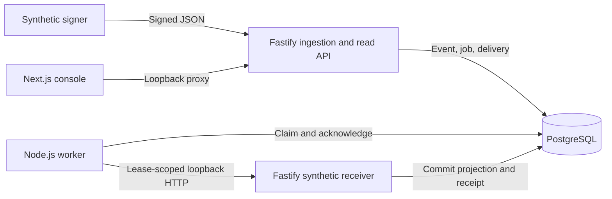

# Architecture

## Ingestion and identity

The API validates HMAC over the exact body bytes, checks the timestamp, and parses allowed fields only after authentication. Each handled submission creates a unique delivery ID. An accepted provider event also creates an immutable internal event ID and the original job. Event, delivery, and original job commit atomically. Concurrent inserts arbitrate on the unique `(source, provider_id)` constraint. Identical bytes are acknowledged as duplicates. A different hash with the same provider identifier is a conflict.

A rejected signature leaves an untrusted delivery record containing a digest, receipt time, source, and fixed diagnostic. An event without an authenticated and validated provider identifier can be investigated by delivery ID. Requests rejected earlier by HTTP limits do not have a delivery record.

## Processing and ordering

The queue grants short leases. Claim selection and attempt creation commit together. A short transaction advisory lock serializes allocation of up to four cluster-wide active jobs. Row locking protects the selected candidate. The worker sends only the job and lease identifiers to a fixed loopback receiver. Each process takes one job at a time. Failures schedule `min(cap, base × 2^(attempt−1))`. When the final attempt fails, the job enters `dead_letter`.

The receiver validates the current lease and holds a transaction advisory lock keyed to the job. It applies snapshots through a conditional upsert on `(source, stream)`. Only a strictly larger sequence changes the projection. Lower and equal sequence numbers are recorded as stale, and gaps are permitted for snapshots. The receiver commits its result receipt with the projection or commits a synthetic failure record and returns HTTP 503.

## Interruption and replay

The receiver's effect transaction and the worker's acknowledgement are independent. When a worker disappears, its active attempt remains visible until another worker recovers the expired lease. Recovery coordinates with the receiver transaction using the same advisory lock. An available attempt retries with a fresh lease. The receiver returns the existing receipt when it sees an event it already processed. On the last attempt, an ambiguous acknowledgement can reconcile against a committed receipt without increasing the attempt budget.

A manual replay creates a separate execution with a different job ID and a single approval record. It shares the original event ID and receipt. The API builds reports from a repeatable-read snapshot.

The default lease is eight seconds and the HTTP timeout is 2.5 seconds. Worker health uses the latest one-second heartbeat and a five-second liveness threshold. The test harness sets shorter leases and backoff delays and can temporarily delay acknowledgement so it can terminate the actual worker process in the intended window.
